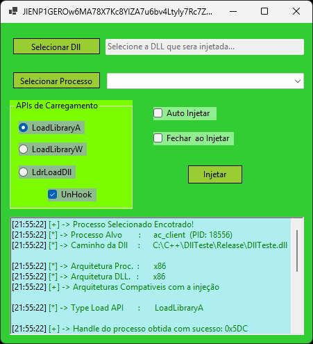

# DLL Injector

  

Aplicativo desenvolvido em C# (Windows Forms) para realizar a injeção de bibliotecas dinâmicas (DLLs) em processos do Windows. O projeto utiliza bibliotecas nativas desenvolvidas em C++ para executar suas principais operações, oferecendo diferentes métodos de carregamento, seleção de processos e automatização do procedimento de injeção.

## Funcionalidades

### Selecionar DLL

Abre uma janela de seleção de arquivos para escolher a DLL que será injetada no processo de destino.

Após a seleção, o aplicativo exibe o nome do arquivo e sua respectiva arquitetura (x86 ou x64).

### Selecionar Processo

Permite selecionar o processo de destino por meio de uma lista de processos em execução.

Somente é exibido para escolha processos da mesma arquitetura do Injetor.

Após escolher o processo no ComboBox, é necessário clicar no botão **Selecionar Processo** para confirmar a seleção.

Quando selecionado, o aplicativo exibe uma mensagem de confirmação e informa a arquitetura do processo de destino.

### APIs de Carregamento

Disponibiliza três métodos de carregamento para realizar a injeção da DLL:

* **LoadLibraryA:** utiliza a API do Windows `LoadLibraryA` para carregar a biblioteca por meio de uma string ANSI.
* **LoadLibraryW:** utiliza a API do Windows `LoadLibraryW` para carregar a biblioteca por meio de uma string Unicode.
* **LdrLoadDll:** utiliza a função interna não documentada `LdrLoadDll`, pertencente ao `ntdll.dll`.

Cada método possui particularidades próprias quanto à forma de carregamento da biblioteca.

### UnHook

Ao habilitar esta opção, o aplicativo realiza a restauração dos bytes originais da API de carregamento selecionada no processo de destino antes de iniciar a injeção.

O procedimento utiliza os bytes da API correspondente no próprio processo do injetor como referência para a restauração.

Informações relacionadas aos bytes modificados e às proteções de memória são apresentadas no registro de logs.

### Auto Injetar

Permite automatizar o processo de injeção em aplicações que ainda não estão em execução.

Ao habilitar esta opção, o ComboBox de processos é substituído por um campo de texto, no qual deve ser informado o nome do processo desejado.

Após informar o nome e clicar em **Selecionar Processo**, o botão **Auto Injetar** ficará disponível.

Ao acioná-lo, o aplicativo iniciará o monitoramento, aguardando a inicialização do processo especificado. Assim que o processo for localizado, a injeção será realizada automaticamente.

O botão **Cancelar Procura** permite interromper o monitoramento a qualquer momento.

### Fechar ao Injetar

Quando habilitada, esta opção fecha automaticamente o injetor após a conclusão da operação de injeção.

**Observação:** como o aplicativo é encerrado imediatamente após a operação, não haverá tempo para consultar os registros de logs na interface.

### Injetar

Executa a injeção da DLL no processo selecionado, respeitando as configurações e o método de carregamento escolhidos pelo usuário.

### Auto Injetar

Botão disponibilizado quando a funcionalidade de injeção automática está habilitada.

Inicia o monitoramento do sistema e realiza a injeção automaticamente assim que o processo de destino é localizado.

### Cancelar Procura

Permite interromper o monitoramento do processo de destino iniciado pela funcionalidade **Auto Injetar**.

## Bibliotecas Nativas

O injetor utiliza bibliotecas DLL desenvolvidas em C++ para implementar suas principais funcionalidades.

|Biblioteca|Descrição|
|-|-|
|`DllLdrLoadDll.dll`|Realiza a injeção utilizando a função interna `LdrLoadDll`.|
|`DllLoadA.dll`|Realiza a injeção utilizando a API `LoadLibraryA`.|
|`DllLoadW.dll`|Realiza a injeção utilizando a API `LoadLibraryW`.|
|`SeDebugPrivilegeDll.dll`|Habilita o privilégio `SeDebugPrivilege` para o processo do injetor.|
|`UnHookDLL.dll`|Realiza a restauração dos bytes originais da API de carregamento selecionada no processo de destino.|

Cada biblioteca possui uma implementação específica, sendo responsável por executar uma determinada operação solicitada pelo aplicativo principal.

## Registro de Logs

O aplicativo possui um sistema de registro de logs responsável por apresentar informações detalhadas sobre o procedimento de injeção.

Entre as informações exibidas estão:

* Etapas executadas durante a operação.
* Confirmação de operações concluídas.
* Informações sobre as APIs utilizadas.
* Dados relacionados à restauração de bytes.
* Informações sobre proteções de memória.
* Mensagens de erro e possíveis falhas durante a execução.

O sistema de logs permite acompanhar o procedimento e facilitar a identificação de possíveis problemas.

## Características Técnicas

### Execução como Administrador

O aplicativo está configurado para solicitar privilégios administrativos durante sua inicialização.

Essa configuração é necessária para permitir a execução das operações que exigem permissões elevadas no sistema operacional.

### SeDebugPrivilege

Durante a inicialização, o aplicativo utiliza a biblioteca `SeDebugPrivilegeDll.dll` para habilitar o privilégio `SeDebugPrivilege`.

Esse privilégio permite ao processo obter acesso a determinados processos protegidos pelas permissões convencionais do Windows, respeitando as restrições impostas pelo sistema operacional.

### Arquitetura

O injetor verifica a arquitetura dos processos e das DLLs selecionadas, permitindo identificar incompatibilidades entre as arquiteturas x86 e x64.

Essa verificação auxilia na prevenção de tentativas de injeção com arquiteturas incompatíveis.

